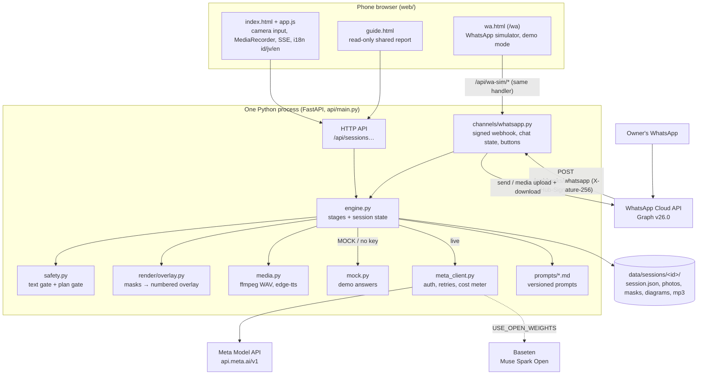
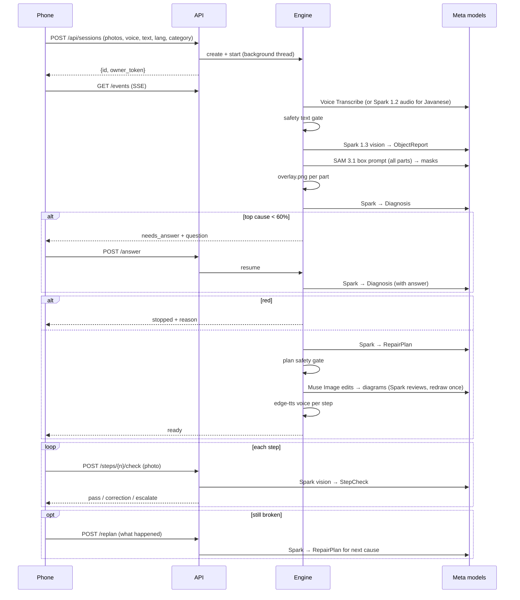
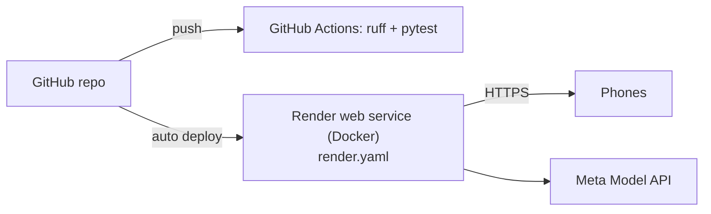

# Architecture

## Components

Design rules:
- **Two front doors, one engine.** The phone app and the WhatsApp channel (`api/channels/whatsapp.py`) both call `engine.create` / `engine.run` and go through the same safety gate; WhatsApp only changes how messages come in and go out (docs/WHATSAPP.md). The `/wa` simulator feeds the same handler with Cloud-API-shaped messages in demo mode; tests use a fake Graph API (`api/testing/fake_graph.py`).
- **Owner token.** `POST /api/sessions` returns an `owner_token` once; the owner's browser keeps it in localStorage and sends it as `X-Owner-Token` to set the outcome or erase the repair. A shared guide link (`/guide/{id}`) does not carry it, so a viewer gets 403. It is never returned by any GET.
- **One file talks to Meta** (`api/meta_client.py`): auth header, retries with backoff on 429/5xx, timeouts, cost charging. Nothing else imports `httpx` for Meta.
- **Every model output is validated** by a pydantic schema (`api/schemas.py`) and retried once with the validation error.
- **Every stage writes its status** into `session.json`, so the UI and SSE never need a database or queue.
- **Demo mode is the same code path** with `mock.py` returning the model answers, so tests exercise the real engine.

## Sequence of one repair

## Session state (`data/sessions/<id>/session.json`)

| Field | Meaning |
|---|---|
| `status` | `created` → `running` → `needs_answer` / `ready` / `stopped` / `exhausted` / `error` |
| `stages` | per stage: `waiting`, `running`, `done`, `skipped`, `stopped` + note + ms |
| `object_report`, `diagnosis`, `plan` | validated model outputs |
| `parts` | component id → label, name, found, highlight image |
| `diagrams`, `audio`, `checks` | per step |
| `safety` | level, reason, disclaimer |
| `cause_index`, `history` | re-plan state |
| `cost` | spent / budget / by model |

Files next to it: `photo1..3.jpg`, `parts.jpg`, `part_<id>.jpg`, `diagram_<n>.png`, `voice_<cause>_<n>.mp3`, `check_<cause>_<n>_<try>.jpg`. The voice recording (`voice.wav`) is deleted right after transcription. Whole sessions are deleted after `RETENTION_HOURS` (startup sweep).

## Deployment

- `Dockerfile`: python:3.12-slim + ffmpeg + DejaVu font, runs `uvicorn api.main:app`.
- `render.yaml`: Blueprint with `MODEL_API_KEY`/`BASETEN_API_KEY` (and the optional `IMPACT_TOKEN`, `PUBLIC_BASE_URL` and four WhatsApp values `WA_TOKEN`, `WA_PHONE_NUMBER_ID`, `WA_VERIFY_TOKEN`, `WA_APP_SECRET`) as secret env vars, health check `/health`.
- `docker-compose.yml`: same container locally.
- Storage is the container disk: fine for a demo (sessions are temporary by design). For scale, see ROADMAP (R2).

## Why not Next.js + separate backend (as the first spec said)?
See [DECISIONS.md](DECISIONS.md#d1). Short version: one process, no build step, nothing for a non-developer to break, and judges get one URL.
