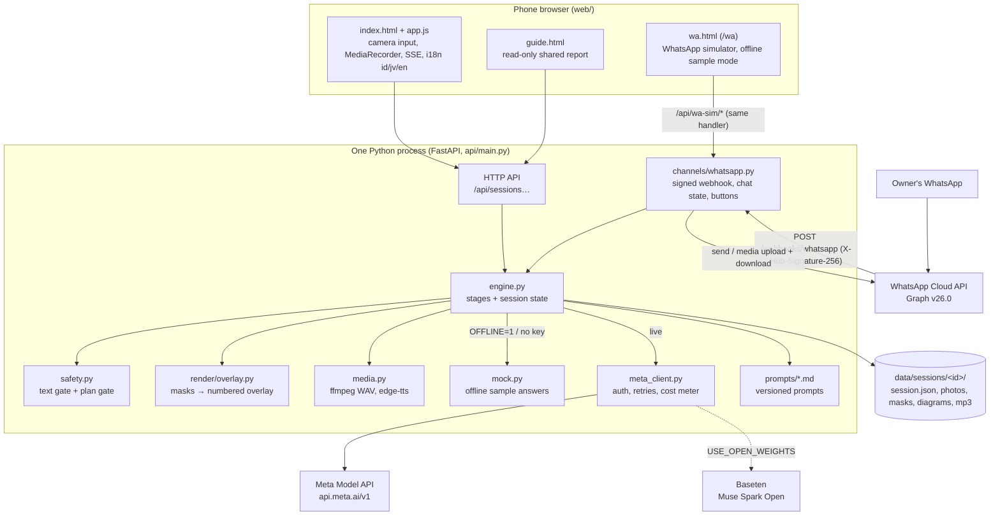
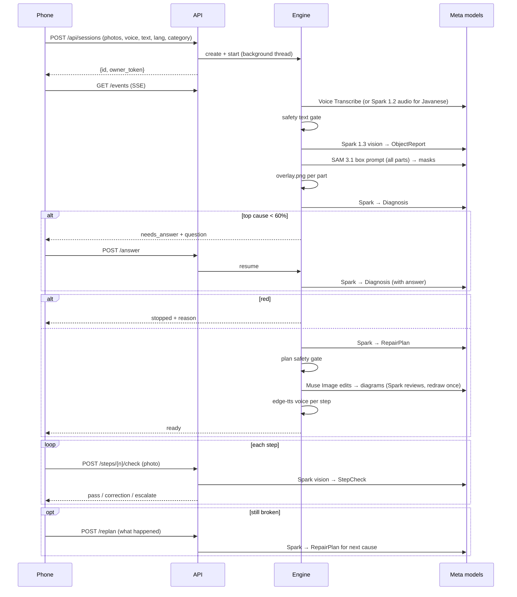
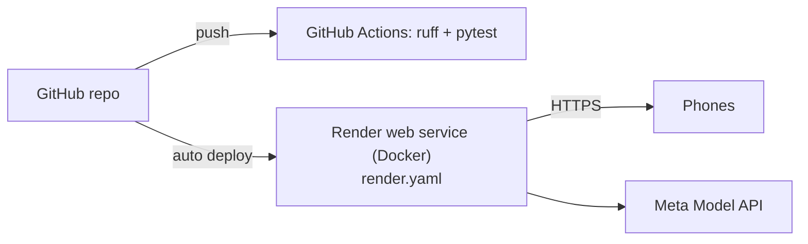

# Architecture

## Components

How it hangs together:

- The phone app and the WhatsApp channel (`api/channels/whatsapp.py`) share one engine. Both call `engine.create` / `engine.run` and go through the same safety gate; WhatsApp only changes how messages come in and go out (docs/WHATSAPP.md). The `/wa` simulator feeds the same handler with Cloud-API-shaped messages in offline sample mode, and the tests use a Graph API test double (`api/tests/doubles/fake_graph.py`).
- `POST /api/sessions` returns an `owner_token` once. The owner's browser keeps it in localStorage and sends it as `X-Owner-Token` to set the outcome or erase the repair. A shared guide link (`/guide/{id}`) doesn't carry it, so a viewer gets 403, and no GET ever returns it.
- Only `api/meta_client.py` talks to Meta: auth header, retries with backoff on 429/5xx (honouring `Retry-After`), timeouts, cost charging. Nothing else imports `httpx` for Meta.
- A pydantic schema (`api/schemas.py`) validates every model output, and a failed validation is retried once with the error attached.
- Every stage writes its status into `session.json`, so the UI and SSE need no database or queue.
- Offline sample mode runs the same code path, with `api/pipeline/mock.py` returning pre-written sample answers in place of the model calls, so the tests exercise the real engine. The live path was run end to end on the real API on 5 Nov 2026 (docs/LIVE_RUN.md).

## Sequence of one repair

## Session state (`data/sessions/<id>/session.json`)

| Field | Meaning |
|---|---|
| `status` | `created` → `running` → `needs_answer` / `ready` / `stopped` / `exhausted` / `error` |
| `stages` | per stage: `waiting`, `running`, `done`, `skipped`, `stopped` + note + ms |
| `object_report`, `diagnosis`, `plan` | validated model outputs |
| `parts` | component id → label, name, found, highlight image |
| `diagrams`, `audio`, `checks` | per step |
| `safety` | level, reason, disclaimer |
| `cause_index`, `history` | re-plan state |
| `cost` | spent / budget / by model |

Files next to it: `photo1..3.jpg`, `parts.jpg`, `part_<id>.jpg`, `diagram_<n>.png`, `voice_<cause>_<n>.mp3`, `check_<cause>_<n>_<try>.jpg`. The voice recording (`voice.wav`) is deleted right after transcription. Whole sessions are deleted after `RETENTION_HOURS` (startup sweep).

## Deployment

- `Dockerfile`: python:3.12-slim + ffmpeg + DejaVu font, runs `uvicorn api.main:app`.
- `render.yaml`: Blueprint with `MODEL_API_KEY`/`BASETEN_API_KEY` (and the optional `IMPACT_TOKEN`, `PUBLIC_BASE_URL` and four WhatsApp values `WA_TOKEN`, `WA_PHONE_NUMBER_ID`, `WA_VERIFY_TOKEN`, `WA_APP_SECRET`) as secret env vars, health check `/health`.
- `docker-compose.yml`: same container locally.
- Storage is the container disk. That's fine for a demo, since sessions are temporary anyway. For scale, see ROADMAP (R2).

## Talking to the live API

These are the parts of `meta_client.py` that exist because of what the real API did on 5 Nov 2026 (docs/LIVE_RUN.md,
docs/META_API_NOTES.md). I'm writing them down because none of them is obvious from the code alone.

| What the API does | What the client does |
|---|---|
| A non-streamed structured call that reasons for more than about 20 s gets a gateway `504 upstream request deadline exceeded` | `chat_json` always sends `stream: true` with `stream_options.include_usage`, joins the `delta.content` chunks and reads token usage from the last chunk |
| Under constrained decoding, a property missing from `required` is simply left out | `schemas.json_schema()` lists every property as required at every depth; "nothing to say" is an empty list or string, never a missing key |
| Reasoning tokens count against `max_tokens` (a hard prompt with 3000 returned no content) | no `max_tokens` on Muse Spark 1.3 calls; the per-repair cost cap is the limit instead |
| Muse Image cannot stream and sometimes hits the same 504 at high effort | one more try at high effort, then the same request at low effort; if that fails too the step shows the photo with the part highlighted instead |
| 429 / 503 may carry `Retry-After` | honoured in seconds, capped at 30 s; 400/401/403 are never retried |
| SAM 3.1 answers as a server-sent event stream with the masks in one delta | parsed with Meta's `meta-sam-parser`; zero masks is a normal "not found", shown as such |

A repair is about seven model calls in sequence (look, SAM, diagnose, maybe a question and a second diagnose, plan,
optional diagram and review), so a live repair takes 1 to 2 minutes. The progress screen streams each stage's result
as soon as it exists, so the owner reads what Muse Spark saw and sees the SAM outlines long before the plan is ready.

## Failure handling and limits

- A stage that fails after the client's retries stops the repair with `status: error`, a plain message in the owner's
  language and a Retry button (`POST /retry` resumes from that stage). `DEMO_FALLBACK=1` would finish the stage with a
  labelled sample answer instead; it is off by default and `scripts/deploy_check.py` fails a live deploy where a session
  needed it.
- Spend: `MAX_COST_PER_SESSION_USD` (default $0.50) is checked before every call; `DAILY_BUDGET_USD` (default $10) is a
  rolling 24 h cap for the whole site; `RATE_LIMIT_PER_HOUR` limits new repairs per visitor; step checks, follow-ups
  and live camera frames have their own caps.
- Uploads: photos up to 15 MB, audio 20 MB, video 40 MB, live camera frames 3 MB, checked while streaming (413 past the
  limit). The type is checked by extension and by actually decoding the file, so a renamed file is refused in the
  owner's language. Owner text is capped at 2,000 characters.
- Logs: one access line per request with an `X-Request-ID` (also sent back to the browser), no query strings and no
  owner text. Every log line, traceback included, goes through `api/logs.py`, which removes the configured keys and
  anything shaped like a token before it is written.
- Browser side: strict Content-Security-Policy (no inline scripts), `X-Content-Type-Options`, `Referrer-Policy:
  no-referrer`, a camera/microphone-only `Permissions-Policy`, HSTS behind https, no `Server` header, and no CORS unless
  `CORS_ORIGINS` names a site.

## Next.js and a separate backend
The first spec asked for them. I went with one process instead: no build step, less for someone who doesn't code to break, and judges get one URL. Details in [DECISIONS.md](DECISIONS.md#d1).
