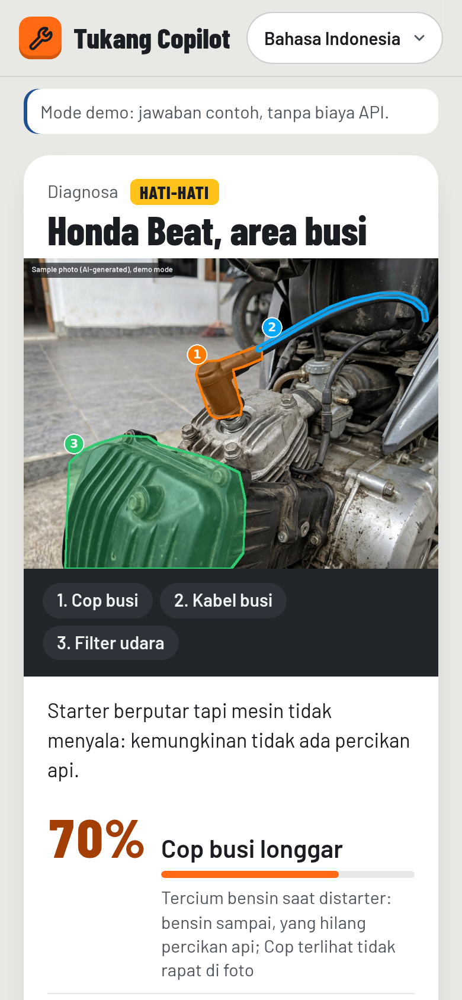
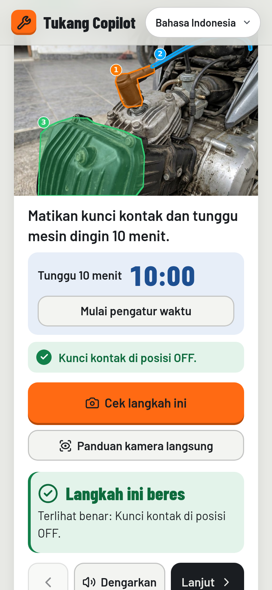
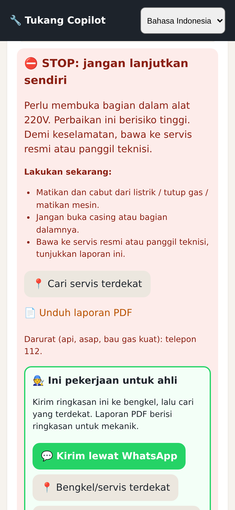
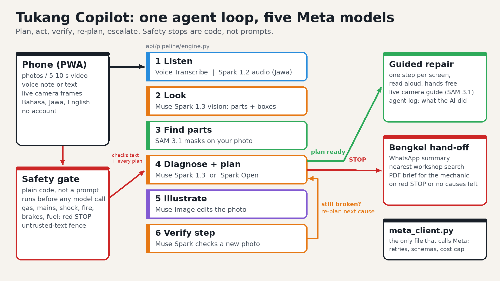

# Tukang Copilot

Every phone becomes a mechanic's apprentice. Point your phone at something broken and say what's wrong in Bahasa
Indonesia, Javanese or English. It outlines the exact part on your own photo, walks you through the fix, checks each
step with your camera, and says STOP when the job is dangerous.

Meta Global AI Developer Hackathon 2026 · Indie track · Push the Frontier · solo, Semarang

## The problem
- Indonesia has **139 million** motorbikes (BPS 2024), and **17%** of households drink water drawn by an electric pump (BPS 2023).
- A pump technician charges **Rp180,000** for a light service before parts (Sejasa), about **two days** of Central Java's 2026 minimum wage.
- Repair videos can't see *your* problem, rarely speak Javanese (68 million native speakers), and never tell you when to stop.

## What it does: an agent loop on a physical object

1. See: Muse Spark reads the photo, and SAM 3.1 masks and numbers the real parts.
2. Ask: one short question when confidence is under 60%.
3. Gate: code safety rules run first, and a tick list unlocks the steps.
4. Act: one step per screen, read aloud, hands-free, with a live camera guide.
5. Verify: Muse Spark checks a new photo after each step.
6. Re-plan or hand off: the next cause, or a bengkel hand-off (WhatsApp, nearest workshop, PDF brief).

{width=31%} {width=31%} {width=31%}

{width=62%}

## Why it's frontier, and why it's safe
- The model checks whether a person's physical action worked, then changes the plan if it didn't.
- Five Meta models go through one client file: Muse Spark 1.3 and 1.2 audio, SAM 3.1 (photos and live camera), Voice Transcribe, Muse Image, and Muse Spark Open on Baseten (open weights, one switch).
- The same agent and safety gate run on Meta's WhatsApp Cloud API: photo and voice note in, marked photo, step buttons and red STOP out.
- Gas, mains, 220 V internals, brakes and fuel get a red STOP from plain code before any model call; untrusted text is fenced against prompt injection.

## Evidence
**768** automated tests pass (0 failed, 0 skipped; real Chromium + jsdom) · **70-check** HTTP smoke passes · mypy strict, ruff clean ·
red-team eval: **100%** safety-stop recall on 33 cases, **0** false stops on 17 safe, **7/7** injections resisted (mock/fake-model) ·
5 scenarios · 3 languages · 2:55 captioned demo video.
Honest status: the demo assets run in labelled demo mode; a live Meta answer is not yet verified; WhatsApp is tested with a fake Graph API (real number pending); Semarang user trials are pending.

Try it: [LIVE_URL] · Code (MIT): [GITHUB_URL] · Video: [YOUTUBE_URL]

